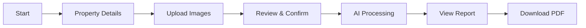

# InspectAI — AI Property Inspection Platform


<p align="center">
  <strong>InspectAI</strong> is an AI-powered property inspection platform that combines classical computer vision with Google Gemini's multimodal AI to detect, classify, and report structural defects in property images — automatically.
</p>

<p align="center">
  <a href="#features">Features</a> ·
  <a href="#ai-pipeline">AI Pipeline</a> ·
  <a href="#installation">Installation</a> ·
  <a href="#demo">Demo</a> ·
  <a href="#architecture">Architecture</a> ·
  <a href="#contributing">Contributing</a>
</p>

---

## Project Overview

InspectAI automates property inspections by analyzing uploaded images through a two-stage AI pipeline:

1. **Classical Computer Vision** (OpenCV) — detects damage contours, calculates damage percentages, and generates heatmap overlays.
2. **Multimodal AI** (Google Gemini 1.5 Pro) — semantically classifies damage types, assesses severity, provides repair recommendations, and estimates costs.

The platform outputs a comprehensive, downloadable PDF inspection report with executive summaries, risk assessments, repair timelines, and actionable recommendations — replacing hours of manual inspection with seconds of automated analysis.

### Problem It Solves

Property inspections are traditionally manual, time-consuming, and subjective. Inspectors must physically visit sites, photograph defects, and compile reports — often missing subtle issues or inconsistent severity ratings. InspectAI democratizes professional-grade inspection by making it accessible, consistent, and instantaneous.

---

## Key Features

### 5-Step Inspection Wizard
- **Step 1: Property Details** — Enter property type, address, and inspector info
- **Step 2: Image Upload** — Drag-and-drop multi-image upload with validation
- **Step 3: Review** — Preview and annotate images before analysis
- **Step 4: Processing** — Real-time progress tracking through AI pipeline stages
- **Step 5: Results** — Interactive report with severity-ranked findings

### AI-Powered Analysis
- **Damage Detection** — OpenCV contour analysis identifies defect regions
- **Semantic Classification** — Gemini Vision classifies damage types (cracks, water damage, mold, etc.)
- **Severity Assessment** — AI rates findings as Critical / High / Medium / Low
- **Repair Recommendations** — Step-by-step repair instructions with cost estimates
- **Health Score** — Overall property health grade (A+ to D) with predictions

### Professional Reports
- Executive summary with key metrics
- Severity-ranked finding cards with damage overlays
- Color-coded risk badge and health score ring
- Repair timeline (Immediate / 7 Days / 30 Days / Monitoring)
- Inspection checklist with status tracking
- PDF export via ReportLab
- Multi-inspection comparison with trend analysis

### Analytics Dashboard
- Inspection history with filtering
- Damage type distribution charts
- Risk trend visualization
- Cost estimation summaries

---

## AI Pipeline

```
┌──────────────┐     ┌──────────────┐     ┌──────────────┐     ┌──────────────┐
│  1. Validate │────▶│ 2. Optimize  │────▶│ 3. OpenCV    │────▶│ 4. Gemini    │
│   Image      │     │  for AI      │     │  Analysis    │     │  Vision      │
│              │     │              │     │              │     │              │
│ • Format     │     │ • Resize     │     │ • Contour    │     │ • Classify   │
│ • Size       │     │ • Normalize  │     │   detection  │     │ • Severity   │
│ • Resolution │     │ • Compress   │     │ • Damage %   │     │ • Repair     │
└──────────────┘     └──────────────┘     └──────────────┘     └──────────────┘
                                                                    │
                                                                    ▼
                                                      ┌──────────────────────┐
                                                      │ 5. Merge & Report    │
                                                      │                      │
                                                      │ • Fuse CV + AI       │
                                                      │ • Risk assessment    │
                                                      │ • Health score       │
                                                      │ • PDF generation     │
                                                      └──────────────────────┘
```

For a detailed breakdown, see [PIPELINE.md](docs/PIPELINE.md).

---

## Architecture Overview

```
streamlit_app/
├── ai/                          # Core AI engines
│   ├── gemini_engine.py         # Google Gemini 1.5 Pro integration
│   ├── opencv_engine.py         # Classical CV damage detection
│   ├── inspection_engine.py     # Pipeline orchestrator
│   ├── fusion_engine.py         # Multi-image result merging
│   ├── health_engine.py         # Property health scoring
│   ├── comparison_engine.py     # Multi-inspection comparison
│   ├── image_validator.py       # Input validation
│   └── measurement_engine.py    # Professional measurements
├── database/                    # Persistence layer (SQLite)
├── report/                      # Report generation & rendering
│   ├── report_builder.py        # Report orchestrator
│   ├── summary_engine.py        # Executive summary builder
│   ├── risk_engine.py           # Risk assessment
│   ├── health.py                # Health score rendering
│   ├── findings.py              # Finding card components
│   ├── pdf_generator.py         # PDF export via ReportLab
│   └── ...
├── components/                  # Reusable UI components
├── pages/                       # Streamlit page modules
│   ├── new_inspection.py        # Step 1: Property details
│   ├── upload.py                # Step 2: Image upload
│   ├── review.py                # Step 3: Review
│   ├── processing.py            # Step 4: AI processing
│   ├── results.py               # Step 5: Results
│   ├── report.py                # Full report view
│   ├── history.py               # Inspection history
│   ├── analytics.py             # Analytics dashboard
│   └── ...
├── styles/                      # Custom CSS
├── utils/                       # Utilities
│   ├── validators.py            # Input validation
│   ├── session_manager.py       # Session state management
│   ├── exceptions.py            # Custom exception hierarchy
│   ├── performance.py           # Performance tracking
│   └── image_optimizer.py       # Image preprocessing
└── app.py                       # Main entry point
```

See [ARCHITECTURE.md](docs/ARCHITECTURE.md) for a deep dive.

---

## Technology Stack

| Component | Technology |
|-----------|-----------|
| **Frontend** | Streamlit 1.55 |
| **AI Vision** | Google Gemini 1.5 Pro (`google-generativeai`) |
| **Computer Vision** | OpenCV 4.13 (`opencv-python-headless`) |
| **Image Processing** | Pillow 12, NumPy 2.3 |
| **PDF Generation** | ReportLab 5.0 |
| **Data Visualization** | Matplotlib 3.10, Altair 6.0, Pandas 2.3 |
| **Configuration** | python-dotenv |
| **Language** | Python 3.10+ |

---

## Folder Structure

```
inspectai/
├── streamlit_app/              # Application source
│   ├── ai/                     # AI engines & pipeline
│   ├── database/               # Persistence layer
│   ├── report/                 # Report generation
│   ├── components/             # UI components
│   ├── pages/                  # Page modules
│   ├── styles/                 # CSS
│   ├── utils/                  # Utilities
│   └── app.py                  # Entry point
├── tests/                      # Test suite (pytest)
│   ├── conftest.py
│   ├── test_image_validator.py
│   ├── test_session_manager.py
│   ├── test_gemini_engine.py
│   ├── test_report_modules.py
│   └── test_integration.py
├── docs/                       # Documentation
│   ├── ARCHITECTURE.md
│   ├── PIPELINE.md
│   ├── DATABASE.md
│   └── DEPLOYMENT.md
├── requirements.txt
├── pyproject.toml
├── README.md
├── CHANGELOG.md
├── CONTRIBUTING.md
├── CODE_OF_CONDUCT.md
└── LICENSE
```

---

## Installation

### Prerequisites
- Python 3.10 or higher
- A Google Gemini API key ([Get one here](https://aistudio.google.com/app/apikey))

### Steps

```bash
# Clone the repository
git clone https://github.com/<your-username>/inspectai.git
cd inspectai

# Create a virtual environment
python -m venv .venv
source .venv/bin/activate  # On Windows: .venv\Scripts\activate

# Install dependencies
pip install -r requirements.txt

# Install development dependencies (for testing/linting)
pip install pytest pytest-cov black ruff mypy
```

---

## Environment Variables

Create a `.env` file in the project root:

```env
# Required
GEMINI_API_KEY=your_google_gemini_api_key_here

# Optional
INSPECTAI_LOG_LEVEL=INFO
INSPECTAI_DB_PATH=data/inspectai.db
```

See [`.env.example`](.env.example) for all available variables.

---

## Running Locally

```bash
# Activate virtual environment
source .venv/bin/activate  # On Windows: .venv\Scripts\activate

# Run the Streamlit app
streamlit run streamlit_app/app.py
```

The app will open at `http://localhost:8501`.

### Running Tests

```bash
# Run all tests with coverage
pytest tests/ --cov=streamlit_app --cov-report=html

# Run specific test file
pytest tests/test_gemini_engine.py -v

# Run linting
ruff check streamlit_app/ tests/
black --check streamlit_app/ tests/
```

---

## Demo

### Inspection Workflow



### Sample Inspection Report

The generated report includes:

| Section | Content |
|---------|---------|
| Executive Summary | Property name, date, inspector, health score |
| Health Dashboard | Grade badge, risk level, category scores |
| Risk Assessment | Composite risk score with color coding |
| Detailed Findings | Severity-ranked cards with damage overlays |
| Repair Timeline | Immediate / 7-day / 30-day / monitoring buckets |
| Recommendations | Immediate actions, repair priorities, maintenance tips |
| Checklist | Category-by-category inspection status |
| PDF Export | Downloadable report for client records |

> **Screenshots** — Add screenshots of the dashboard, upload page, processing view, and sample report. Replace the placeholders below with actual images.

```
docs/assets/screenshots/
├── dashboard.png        # Main dashboard with inspection stats
├── upload.png           # Image upload interface
├── processing.png       # Real-time processing progress
├── results.png          # Inspection results with findings
├── report.png           # Full inspection report
└── analytics.png        # Analytics dashboard
```

---

## Performance

| Metric | Value |
|--------|-------|
| **Single Image Analysis** | ~3–8 seconds (CV + Gemini) |
| **Batch Processing** | ~5–15 seconds per image (with retries) |
| **Report Generation** | <1 second |
| **PDF Export** | ~2 seconds |
| **Test Suite** | 322 tests, ~7 seconds |
| **Code Coverage** | 29% (unit + integration tests) |
| **Supported Image Formats** | JPEG, PNG, BMP, TIFF, WebP |
| **Max Image Resolution** | 4K (auto-downsampled to 1024px max dimension) |
| **Max File Size** | 15 MB per image |
| **Batch Size Limit** | 20 images per inspection |

### Optimization Strategies
- Images are automatically downsampled before CV analysis (`max_dimension=1024`)
- OpenCV uses headless mode to avoid GUI overhead
- Gemini API calls include retry logic with exponential backoff
- Report data is lazily built per section

---

## Future Roadmap

> These are planned improvements for future releases.

- **Authentication** — User accounts with inspection history persistence
- **Database** — SQLite/SQLAlchemy persistence layer for inspection records
- **Multi-language** — Internationalization for reports (English, Spanish, Hindi)
- **Drone Integration** — Support for drone-captured aerial imagery
- **AR View** — Augmented reality overlay for on-site damage visualization
- **IoT Integration** — Connect to building sensor data for continuous monitoring
- **Mobile App** — Native iOS/Android app for field inspectors
- **Multi-model AI** — Support for GPT-4 Vision and Claude Vision as alternatives to Gemini
- **API Layer** — REST API for third-party integrations
- **Advanced Analytics** — Predictive maintenance scheduling based on inspection history

---

## License

This project is licensed under the MIT License — see the [LICENSE](LICENSE) file for details.

---

## Contributing

See [CONTRIBUTING.md](CONTRIBUTING.md) for development setup, coding standards, and the pull request process.

---

<p align="center">
  Built with <a href="https://streamlit.io">Streamlit</a>, <a href="https://ai.google.dev">Gemini</a>, and <a href="https://opencv.org">OpenCV</a>
</p>
