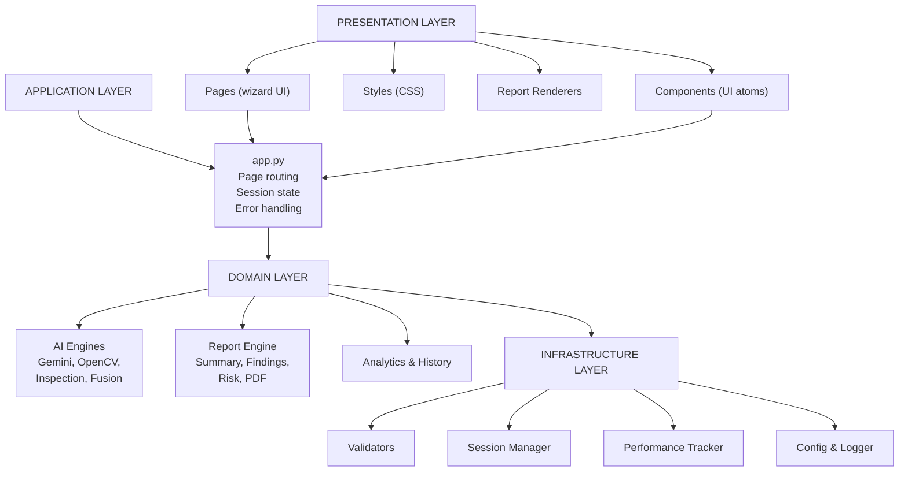

# InspectAI — Architecture Documentation

## Overview

InspectAI is a **layered, pipeline-oriented** Python application built on Streamlit. The architecture separates concerns into four distinct layers: **Presentation**, **Application**, **Domain**, and **Infrastructure**.



## Layer Responsibilities

### Presentation Layer
- **Pages** — Streamlit page modules implementing the 5-step wizard and sidebar pages
- **Components** — Reusable UI atoms (info boxes, metric cards, file uploaders)
- **Styles** — Custom CSS injected via `inject_custom_css()`
- **Report Renderers** — Pure rendering functions that display structured report data

**Rule:** Pages and components must not contain business logic. They receive data from the Application layer and render it.

### Application Layer
- **`app.py`** — The single entry point. Handles:
  - Page routing via `PAGE_REGISTRY`
  - Session state initialization
  - Global error handling via `_safe_render()`
  - Navigation between wizard steps

**Rule:** `app.py` is the only module that calls `st.rerun()` and manages navigation state.

### Domain Layer
The core of the application. Contains all business logic for inspection analysis.

#### AI Engines (`streamlit_app/ai/`)
| Module | Responsibility |
|--------|---------------|
| `image_validator.py` | Validates image format, size, resolution |
| `image_optimizer.py` | Downsamples and normalizes images for AI processing |
| `opencv_engine.py` | Classical CV — contour detection, damage percentage, heatmaps |
| `gemini_engine.py` | Gemini Vision API — semantic classification, severity, repair steps |
| `inspection_engine.py` | Pipeline orchestrator — runs stages sequentially, merges results |
| `fusion_engine.py` | Merges multi-image results into a unified `FusedInspection` |
| `health_engine.py` | Property health scoring with category breakdowns |
| `comparison_engine.py` | Compares multiple inspections for trend analysis |
| `measurement_engine.py` | Professional measurement data extraction |

#### Report Engine (`streamlit_app/report/`)
| Module | Responsibility |
|--------|---------------|
| `report_builder.py` | Orchestrates all report sections |
| `summary_engine.py` | Pure functions building `ExecutiveSummary`, `FindingRecord`, `TimelineEntry` |
| `risk_engine.py` | Computes `RiskAssessment` from inspection reports |
| `health.py` | Renders health score rings, grade cards, dashboard |
| `findings.py` | Renders finding cards and severity badges |
| `timeline.py` | Renders repair timeline and checklist |
| `recommendations.py` | Renders immediate actions and maintenance tips |
| `pdf_generator.py` | Generates downloadable PDF via ReportLab |

### Infrastructure Layer
- **Validators** — Pure validation functions with `ValidationResult` returns
- **Session Manager** — `st.session_state` wrappers with typed accessors
- **Performance Tracker** — Stage timing instrumentation
- **Config** — Environment variable loading and validation
- **Logger** — Structured logging with file and console handlers
- **Exceptions** — Custom exception hierarchy for typed error handling

## Design Principles

1. **Pipeline Orientation** — Each inspection flows through discrete stages (validate → optimize → CV → Gemini → merge). Stages are independently testable.

2. **Dataclass-First** — All structured data uses `@dataclass(frozen=True)` for immutability and type safety. Examples: `InspectionReport`, `GeminiAnalysis`, `RiskAssessment`, `FindingRecord`.

3. **Pure Functions for Data** — Report data builders (`summary_engine.py`, `risk_engine.py`) are pure functions — no Streamlit imports, no side effects. This makes them trivially testable.

4. **Separation of Rendering** — Report data construction is separate from report rendering. The `summary_engine.py` builds data; `report/summary.py` renders it.

5. **Graceful Degradation** — If Gemini fails (no API key, rate limit, network error), the pipeline continues with CV-only results. The UI shows "AI analysis unavailable" but still displays CV findings.

6. **Error Boundaries** — Every page renderer is wrapped in `_safe_render()`, which catches exceptions and displays user-friendly messages. Technical details are hidden behind an expander.

## Data Flow

```
User uploads image
       │
       ▼
validate_image() → ValidationResult
       │
       ▼
optimize_for_ai() → Resized numpy array
       │
       ▼
run_full_analysis() → DamageMetrics + processed images
       │
       ▼
analyze_image_with_gemini() → GeminiAnalysis
       │
       ▼
merge_results() → InspectionReport (frozen dataclass)
       │
       ▼
st.session_state["inspection_reports"] = [InspectionReport, ...]
       │
       ▼
build_executive_summary() → ExecutiveSummary
build_findings() → [FindingRecord, ...]
build_timeline() → [TimelineEntry, ...]
build_recommendations() → {immediate_actions, repair_priority, ...}
assess_risk() → RiskAssessment
       │
       ▼
render_report() → Streamlit UI sections
       │
       ▼
generate_report_pdf() → PDF bytes → Download
```

## Module Dependency Graph

```
app.py
 ├── pages/*          → utils/*, components/*
 ├── components/*     → utils/*
 └── utils/*          → (no internal deps)

inspection_engine.py
 ├── image_validator.py  → utils/validators.py
 ├── opencv_engine.py    → (OpenCV, NumPy)
 ├── gemini_engine.py    → google-generativeai
 ├── image_optimizer.py  → utils/performance.py
 └── utils/exceptions.py

report_builder.py
 ├── summary_engine.py   → risk_engine.py
 ├── health.py           → ai/health_engine.py
 ├── findings.py         → (pure rendering)
 ├── pdf_generator.py    → reportlab
 └── components/*        → ui_components.py
```

## Extension Points

The architecture is designed for extension:

- **New AI Providers**: Add a new module in `ai/` implementing the same interface as `gemini_engine.py`. Update `inspection_engine.py` to call it.
- **New Report Sections**: Add a builder function in `summary_engine.py` and a renderer in `report/`. Register it in `report_builder.py`.
- **New Validators**: Add pure functions to `utils/validators.py`. Call them from `image_validator.py` or page modules.
- **New Pages**: Add a renderer function and register it in `PAGE_REGISTRY` in `app.py`.

## Testing Strategy

| Layer | Approach | Coverage |
|-------|----------|----------|
| Validators | Pure function unit tests | High |
| AI Engines | Mocked external APIs (Gemini mocked, OpenCV uses synthetic images) | Medium |
| Report Builders | Pure function tests with synthetic `InspectionReport` objects | High |
| Report Renderers | Integration tests with mocked Streamlit | Low (rendering is hard to test) |
| Pages | Manual + smoke tests (Streamlit pages are inherently hard to unit test) | Low |

See [tests/](tests/) for the full test suite.
