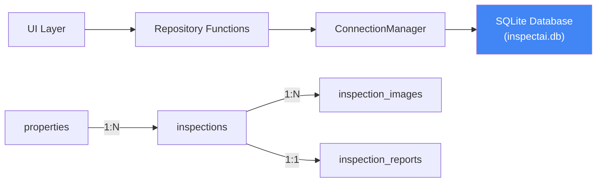

# InspectAI — Database Documentation

## Overview

InspectAI uses **SQLite** as its persistence layer, accessed through a lightweight repository pattern. The database stores properties, inspections, images, and reports — enabling inspection history, analytics, and report retrieval across sessions.



```


## Schema

### Table: properties

Stores property metadata entered during Step 1 of the inspection wizard.

| Column | Type | Constraints |
|--------|------|-------------|
| `property_id` | TEXT | PRIMARY KEY |
| `property_type` | TEXT | NOT NULL, CHECK in (residential, commercial, industrial, institutional, mixed_use, other) |
| `address` | TEXT | |
| `city` | TEXT | DEFAULT '' |
| `state` | TEXT | DEFAULT '' |
| `pincode` | TEXT | DEFAULT '' |
| `year_built` | INTEGER | |
| `area_sqft` | INTEGER | |
| `floors` | INTEGER | |
| `construction_type` | TEXT | |
| `inspector_name` | TEXT | DEFAULT '' |
| `notes` | TEXT | DEFAULT '' |
| `created_at` | TEXT | NOT NULL DEFAULT datetime('now', 'localtime') |
| `updated_at` | TEXT | NOT NULL DEFAULT datetime('now', 'localtime') |

**Indexes:** `idx_properties_type`, `idx_properties_city`

### Table: inspections

Stores inspection session metadata.

| Column | Type | Constraints |
|--------|------|-------------|
| `inspection_id` | TEXT | PRIMARY KEY |
| `property_id` | TEXT | NOT NULL, FK → properties.property_id ON DELETE CASCADE |
| `inspection_date` | TEXT | NOT NULL DEFAULT date('now', 'localtime') |
| `inspector_name` | TEXT | DEFAULT '' |
| `weather_condition` | TEXT | DEFAULT '' |
| `notes` | TEXT | DEFAULT '' |
| `status` | TEXT | NOT NULL DEFAULT 'processing', CHECK in (processing, completed, failed) |

### Table: inspection_images

Stores uploaded images linked to inspections.

| Column | Type | Constraints |
|--------|------|-------------|
| `image_id` | TEXT | PRIMARY KEY |
| `inspection_id` | TEXT | NOT NULL, FK → inspections.inspection_id ON DELETE CASCADE |
| `file_name` | TEXT | NOT NULL |
| `file_path` | TEXT | |
| `file_size_bytes` | INTEGER | |
| `width` | INTEGER | |
| `height` | INTEGER | |
| `format` | TEXT | |
| `uploaded_at` | TEXT | NOT NULL DEFAULT datetime('now', 'localtime') |
| `analysis_status` | TEXT | DEFAULT 'pending', CHECK in (pending, processing, completed, failed) |

### Table: inspection_reports

Stores generated inspection reports (JSON).

| Column | Type | Constraints |
|--------|------|-------------|
| `report_id` | TEXT | PRIMARY KEY |
| `inspection_id` | TEXT | NOT NULL, FK → inspections.inspection_id ON DELETE CASCADE |
| `report_type` | TEXT | DEFAULT 'full' |
| `report_data` | TEXT | NOT NULL (JSON) |
| `health_score` | INTEGER | |
| `risk_level` | TEXT | |
| `total_findings` | INTEGER | |
| `estimated_cost_min` | INTEGER | |
| `estimated_cost_max` | INTEGER | |
| `created_at` | TEXT | NOT NULL DEFAULT datetime('now', 'localtime') |

## Connection Management

**Module:** `streamlit_app/database/database.py`

```python
from streamlit_app.database import get_connection, init_db, ConnectionManager

# Initialize the database (creates tables if not exist)
init_db()

# Get a connection (context manager)
with get_connection() as conn:
    cursor = conn.execute("SELECT * FROM properties")
    rows = cursor.fetchall()

# Or use the connection manager directly
db = ConnectionManager()
db.connect()
# ... use db.conn ...
db.close()
```

### Configuration

| Variable | Default | Description |
|----------|---------|-------------|
| `INSPECTAI_DB_PATH` | `data/inspectai.db` | Path to SQLite database file |

## Repository Pattern

**Module:** `streamlit_app/database/repository.py`

All database access goes through repository functions. The UI layer never executes raw SQL.

### Properties

```python
from streamlit_app.database import create_property, get_property, list_properties

# Create
prop_id = create_property({
    "property_type": "residential",
    "address": "123 Main St",
    "city": "Springfield",
    "state": "IL",
})

# Read
prop = get_property(prop_id)

# List with filters
props = list_properties(property_type="residential", city="Springfield")
```

### Inspections

```python
from streamlit_app.database import create_inspection, get_inspection

insp_id = create_inspection(property_id, inspector_name="John Doe")
insp = get_inspection(insp_id)
```

### Images

```python
from streamlit_app.database import save_inspection_image, get_images_by_inspection

save_inspection_image(inspection_id, image_id, file_name, file_bytes)
images = get_images_by_inspection(inspection_id)
```

### Reports

```python
from streamlit_app.database import save_report, get_report, list_reports

save_report(inspection_id, report_data_json, health_score=85, risk_level="Medium")
report = get_report(report_id)
reports = list_reports(inspection_id=insp_id)
```

### Analytics

```python
from streamlit_app.database import get_dashboard_stats, get_inspection_history

stats = get_dashboard_stats()  # Total inspections, avg health score, etc.
history = get_inspection_history(limit=50, offset=0)
```

## Migrations

**File:** `streamlit_app/database/MIGRATIONS.md`

Schema changes are tracked manually. Each migration includes:
- Version number
- Date
- Description of changes
- SQL statements

Current schema version: tracked by `get_db_version()`.

## Thread Safety

The SQLite connection is **not** thread-safe by default. Streamlit's single-threaded execution model makes this acceptable. If multi-threading is added later, enable WAL mode:

```sql
PRAGMA journal_mode=WAL;
```

## Backup Strategy

```bash
# Backup the database
cp data/inspectai.db data/inspectai.db.backup

# Or via SQL dump
sqlite3 data/inspectai.db .dump > backup.sql
```

## Performance

| Operation | Typical Time |
|-----------|-------------|
| Create property | <10ms |
| Create inspection | <10ms |
| Save image (1MB) | 50–100ms |
| Save report | <20ms |
| List inspections (paginated) | <50ms |
| Full dashboard stats | <100ms |
