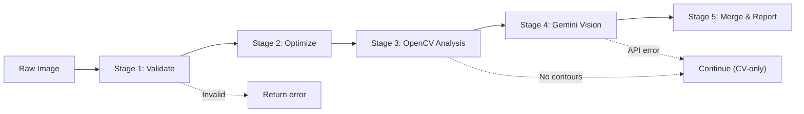
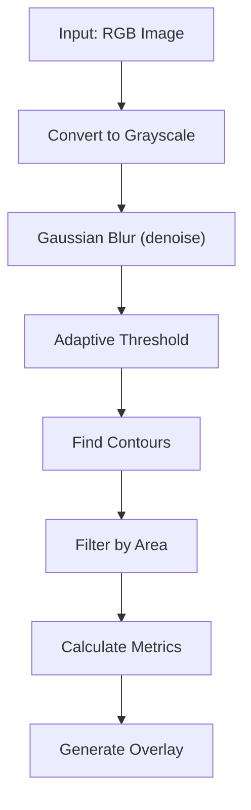
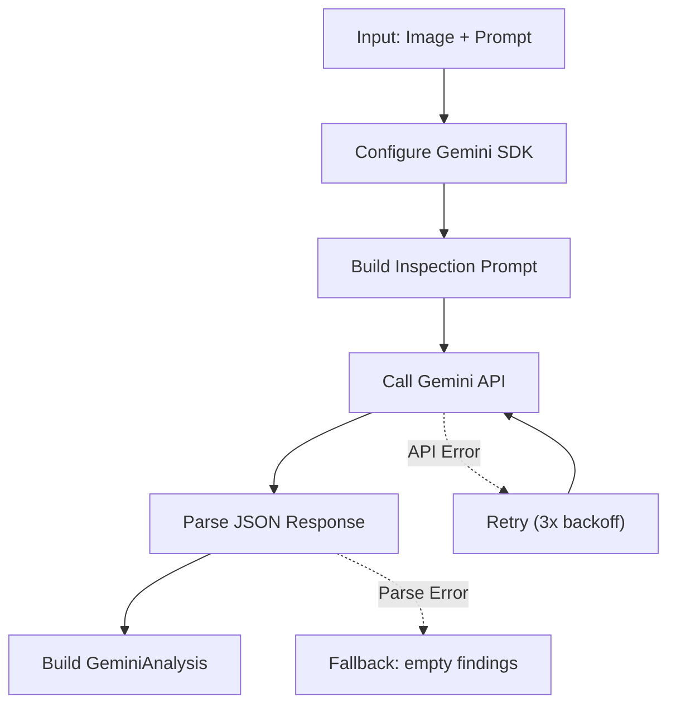
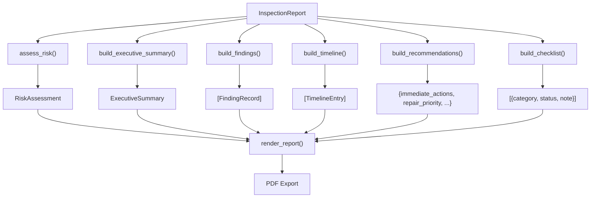

# InspectAI — AI Processing Pipeline

## Overview

The InspectAI pipeline processes property images through five sequential stages, transforming raw uploads into structured inspection reports.



## Stage 1: Image Validation

**Module:** `streamlit_app/ai/image_validator.py`

Validates the uploaded image before any processing occurs.

| Check | Criterion | Action on Failure |
|-------|-----------|-------------------|
| Format | JPEG, PNG, BMP, TIFF, WebP | Raise `ValidationError` |
| File Size | ≤ 15 MB | Raise `ValidationError` |
| Dimensions | ≥ 200×200 px | Raise `ValidationError` |
| Decodability | OpenCV/Pillow can load it | Raise `ValidationError` |

```python
result = validate_image(source, file_name="photo.jpg", file_size_bytes=1024000)
# → ValidationResult(is_valid=True, error="", format="JPEG", width=1920, height=1080)
```

## Stage 2: Image Optimization

**Module:** `streamlit_app/utils/image_optimizer.py`

Prepares the image for AI processing by resizing and normalizing.

| Operation | Detail |
|-----------|--------|
| Resize | Downsample to `max_dimension` (default 1024px) preserving aspect ratio |
| Format | Convert to RGB if needed |
| Memory | Release original after optimization |

```python
optimized = optimize_for_ai(source, file_name="photo.jpg", max_dimension=1024)
# → numpy array (H, W, 3) in RGB format
```

## Stage 3: Classical CV Analysis

**Module:** `streamlit_app/ai/opencv_engine.py`

Runs classical computer vision to detect structural defects.

### Pipeline Steps



### Output: DamageMetrics

| Field | Description |
|-------|-------------|
| `damage_percentage` | % of image area classified as damaged |
| `damage_area_px` | Total damaged pixel count |
| `contour_count` | Number of distinct damage regions |
| `largest_damage_area_px` | Area of the largest single region |
| `image_area_px` | Total image pixel count |

### Generated Artefacts
- **processed** — Preprocessed grayscale/BGR image
- **mask** — Binary damage mask (white = damage)
- **heatmap** — Color-coded intensity heatmap
- **overlay** — Original image with damage contours drawn

```python
processed, mask, heatmap, metrics, overlay = run_full_analysis(image, min_contour_area=100)
```

## Stage 4: Gemini Vision Analysis

**Module:** `streamlit_app/ai/gemini_engine.py`

Sends the image to Google Gemini 1.5 Pro for semantic analysis.

### Process



### Prompt Construction

The prompt instructs Gemini to act as a certified building inspector and return structured JSON:

```json
{
  "findings": [
    {
      "title": "Vertical crack on east wall",
      "severity": "High",
      "confidence": 85,
      "description": "10-inch vertical crack...",
      "location": "East wall, 3ft from ceiling",
      "repair_steps": ["Clean area", "Apply epoxy", "Sand smooth"],
      "cost_min": 500,
      "cost_max": 1500
    }
  ],
  "overall_health_score": 72,
  "summary": "One significant defect found..."
}
```

### Output: GeminiAnalysis

| Field | Description |
|-------|-------------|
| `has_damage` | Whether any findings were detected |
| `damage_type` | Primary damage category |
| `severity` | Critical / High / Medium / Low |
| `confidence` | AI confidence (0–100) |
| `repair_steps` | Ordered repair instructions |
| `estimated_cost_range` | Min–max cost estimate |
| `urgency` | Immediate / Urgent / Moderate / Low |
| `raw_response` | Full Gemini response text |

### Retry Strategy

| Parameter | Value |
|-----------|-------|
| Max Retries | 3 |
| Backoff | Exponential (1s, 2s, 4s) |
| Retryable Errors | 429 (rate limit), 503 (unavailable) |
| Timeout | 30 seconds per request |

## Stage 5: Merge & Report

**Module:** `streamlit_app/ai/inspection_engine.py` → `merge_results()`

Combines CV metrics and Gemini analysis into a single immutable `InspectionReport`.

### InspectionReport Dataclass

```
InspectionReport
├── Image Metadata
│   ├── file_name, image_width, image_height, file_size_mb
│   └── validation_passed, validation_error
├── CV Metrics
│   ├── damage_percentage, damage_area_px, image_area_px
│   ├── contour_count, largest_damage_area_px
├── Gemini Analysis
│   ├── damage_type, severity, confidence
│   ├── possible_causes, repair_steps, recommended_professional
│   ├── estimated_cost_range, urgency, prevention_tips
├── Generated Artefacts
│   ├── processed_image, damage_mask, heatmap, overlay_image
├── Timing
│   ├── cv_processing_time_sec, gemini_processing_time_sec
│   └── total_processing_time_sec
└── Status
    ├── gemini_skipped, gemini_error
    └── measurement_report
```

### Report Building

Once the `InspectionReport` is created, the report engine builds structured display data:



## Batch Processing

For multiple images, `run_batch()` processes each image independently:

```python
reports = run_batch(
    sources=[bytes1, bytes2, bytes3],
    file_names=["wall1.jpg", "ceiling.jpg", "floor.jpg"],
    api_key=os.environ["GEMINI_API_KEY"],
)
# → [InspectionReport, InspectionReport, InspectionReport]
```

Each image gets its own `InspectionReport`. The report builder then merges findings across all reports.

### Batch Retry Logic

- Each image is retried up to 3 times on transient failures
- Failed images produce `InspectionReport` with `gemini_skipped=True`
- Batch processing continues even if individual images fail

## Error Handling

| Stage | Failure Mode | Handling |
|-------|-------------|----------|
| Validation | Invalid format/size | Return `ValidationResult` with error message |
| Optimization | Corrupt image | Pass through; CV stage will fail gracefully |
| OpenCV | No contours found | Continue — empty metrics are valid |
| OpenCV | Processing error | Return `None` metrics; continue with CV-only |
| Gemini | Missing API key | Skip Gemini; use CV-only results |
| Gemini | API error | Retry 3×; skip on final failure |
| Gemini | Parse error | Return empty findings with parse error note |
| Merge | Any stage failed | Build report with available data |

## Performance Characteristics

| Operation | Typical Time | Bottleneck |
|-----------|-------------|------------|
| Validation | <50ms | File I/O |
| Optimization | <100ms | Resize operation |
| OpenCV Analysis | 500ms–2s | Contour detection on large images |
| Gemini API | 2–6s | Network latency + model inference |
| Report Building | <100ms | Pure computation |
| PDF Generation | 1–3s | ReportLab rendering |

**Total per image:** ~3–8 seconds (dominated by Gemini API latency).
